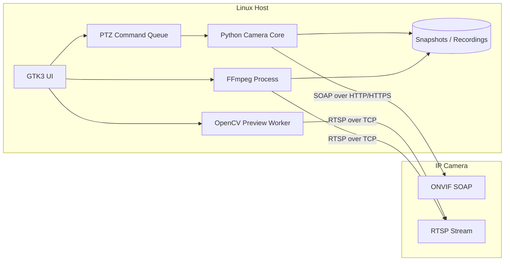
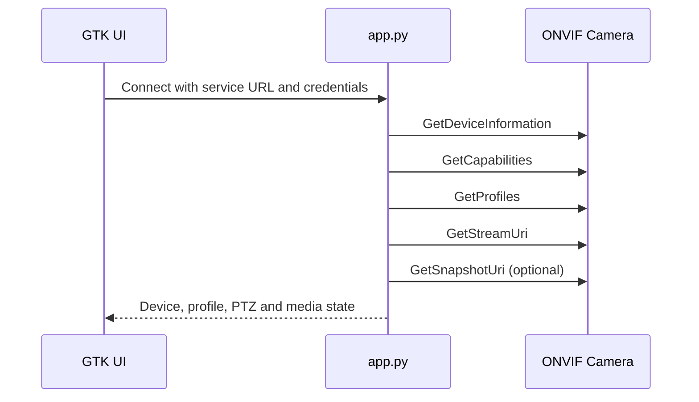

# Architecture

## System design

Network Camera Console is a single-process native Linux application. `desktop_app.py` owns the GTK interface and worker lifecycle; `app.py` provides ONVIF, network and recording helpers.

[中文架构](ARCHITECTURE.zh-CN.md)



ONVIF and RTSP are independent. RTSP provides preview and recording; ONVIF provides device metadata, stream discovery and PTZ.

## Technology stack

| Layer | Technology | Responsibility |
| --- | --- | --- |
| Desktop UI | GTK3, PyGObject, GTK CSS | Native controls, layout, status and theme |
| UI runtime | GLib/GDK | Main loop, thread-safe updates, keyboard and pointer input |
| Preview | OpenCV with FFmpeg backend, GdkPixbuf | Decode, resize and render RTSP frames |
| Core | Python 3 standard library | Configuration, networking, SOAP and worker orchestration |
| ONVIF | SOAP 1.2, HTTP Digest, WS-Security PasswordDigest | Discovery, profiles, stream URI and PTZ |
| Recording | FFmpeg | Copy H.264/HEVC video and convert audio to AAC |
| Storage | Local filesystem | MP4 recordings and JPEG snapshots |

The frontend and backend are modules inside one Python process, not separate services.

## Runtime flow

### ONVIF



Camera-provided service addresses are preferred. If `GetSnapshotUri` is unsupported, the latest RTSP preview frame is saved instead.

### RTSP preview

1. Validate the full RTSP URL and add URL-encoded credentials.
2. Probe the configured TCP endpoint.
3. Open RTSP over TCP through OpenCV's FFmpeg backend.
4. Decode and resize frames in a worker thread.
5. Send only the latest JPEG frame to GTK, dropping stale frames.

### PTZ and recording

- PTZ operations use one queue and one worker to preserve move/stop ordering.
- Movement speed is normalized to the ONVIF range `0.1`–`1.0`.
- FFmpeg copies the first H.264/HEVC video stream without re-encoding.
- The optional first audio stream is converted to AAC for MP4 compatibility.
- Stopping sends `SIGINT` so FFmpeg can finalize the MP4 container.

## Concurrency

| Context | Responsibility |
| --- | --- |
| GTK main thread | UI rendering and input |
| ONVIF worker | Blocking SOAP initialization |
| Preview worker | RTSP decoding and frame preparation |
| PTZ worker | Ordered SOAP movement commands |
| Recording monitor | FFmpeg completion and error reporting |
| FFmpeg process | MP4 writing |

## Source layout

```text
app.py                  ONVIF, network and recording helpers
desktop_app.py          GTK application and workers
run_desktop.sh          Environment loader and launcher
.env.example            Public configuration template
recordings/             Generated MP4 files
snapshots/              Generated JPEG files
```

## Software requirements

- Linux with X11 or Wayland
- Python 3.9+
- GTK3, PyGObject and `gir1.2-gtk-3.0`
- OpenCV Python bindings
- FFmpeg and ffprobe
- Bash

```bash
sudo apt install python3 python3-gi gir1.2-gtk-3.0 python3-opencv ffmpeg
```

## Hardware requirements

| Component | Minimum | Recommended |
| --- | --- | --- |
| CPU | 64-bit ARM/x86, 2 cores | 4 cores or hardware video decoding |
| Memory | 1 GB | 2 GB or more |
| Display | 960 × 680 | 1280 × 800 or higher |
| Network | Route to camera ONVIF/RTSP ports | Ethernet for development plus Wi-Fi camera subnet |
| Camera | RTSP | ONVIF PTZ and H.264/HEVC |

## Technical constraints

- One camera per process
- One credential pair exposed by the current UI
- Lightweight regular-expression ONVIF XML extraction
- No automatic hardware-decoder selection
- No WS-Discovery, presets, patrol, retention policy or disk quota

