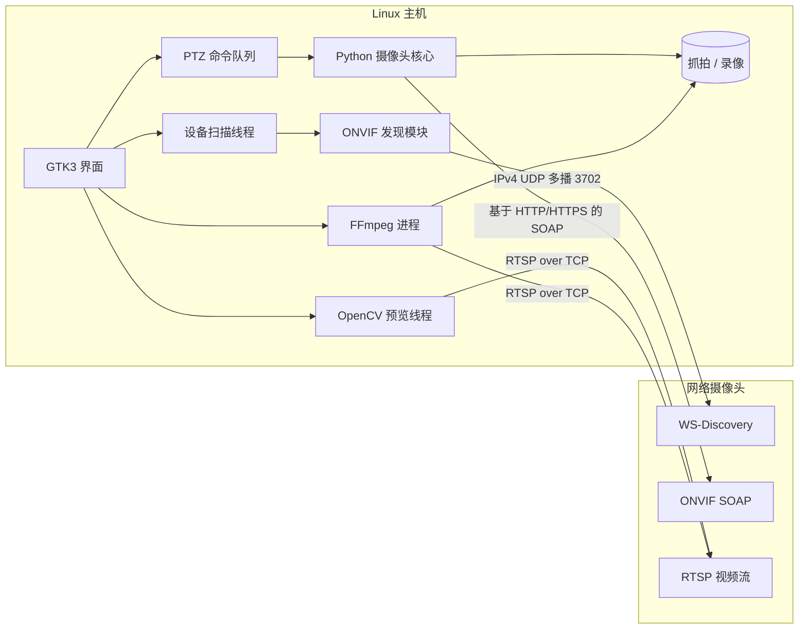
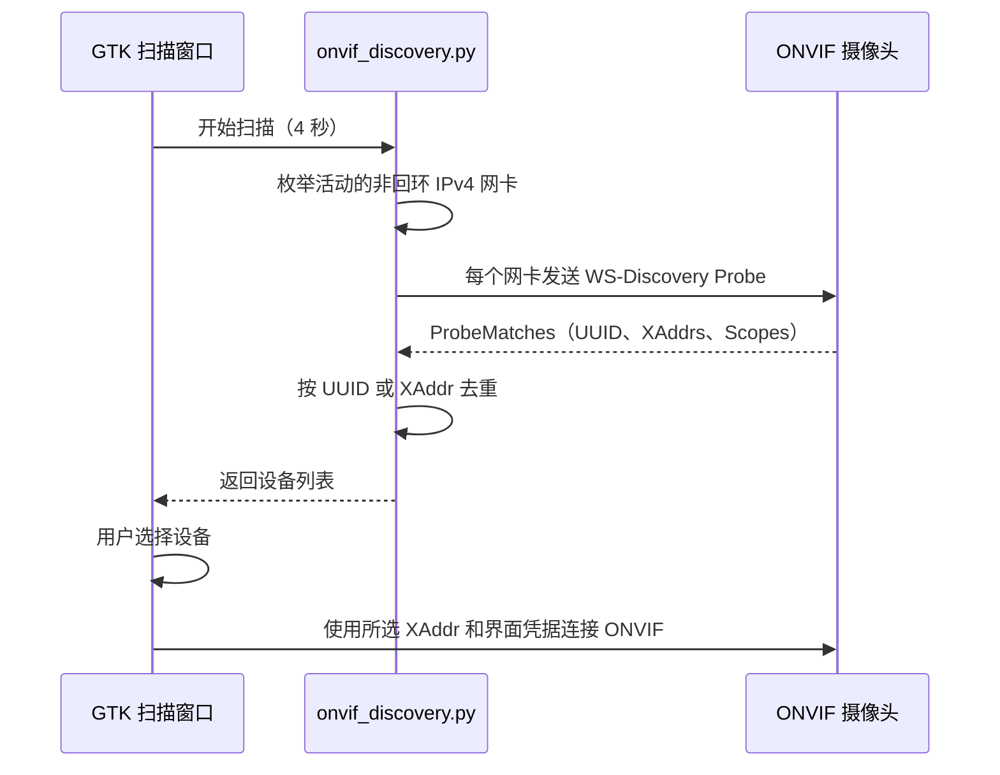
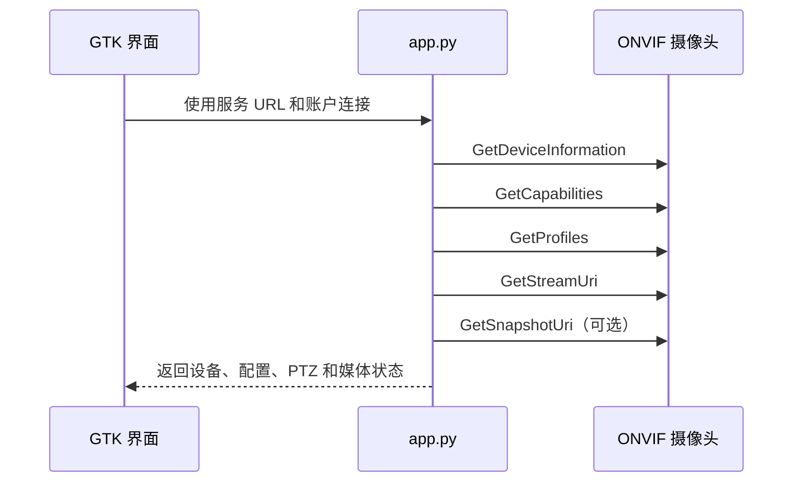

# 架构文档

## 系统设计

网络摄像头控制台是单进程 Linux 原生应用。`desktop_app.py` 负责 GTK 界面和工作线程生命周期，`app.py` 提供 ONVIF、网络与录像辅助功能。

[英文架构](ARCHITECTURE.md)



ONVIF 与 RTSP 相互独立。RTSP 负责预览和录像，ONVIF 负责设备信息、视频流发现和 PTZ。

## 技术栈

| 分层 | 技术 | 职责 |
| --- | --- | --- |
| 桌面界面 | GTK3、PyGObject、GTK CSS | 原生控件、布局、状态和主题 |
| 界面运行时 | GLib/GDK | 主循环、线程安全更新、键盘和指针输入 |
| 视频预览 | 使用 FFmpeg 后端的 OpenCV、GdkPixbuf | 解码、缩放和显示 RTSP 帧 |
| 核心 | Python 3 标准库 | 配置、网络、SOAP 和工作线程编排 |
| ONVIF 发现 | WS-Discovery、IPv4 UDP 多播、ElementTree | 扫描活动网卡、解析设备地址并按设备标识去重 |
| ONVIF 控制 | SOAP 1.2、HTTP Digest、WS-Security PasswordDigest | 设备信息、媒体配置、视频流地址和 PTZ |
| 录像 | FFmpeg | 复制 H.264/HEVC 视频并将音频转换为 AAC |
| 存储 | 本地文件系统 | MP4 录像和 JPEG 抓拍 |

前端和后端是同一个 Python 进程中的模块，不是独立服务。

## 运行流程

### 自动扫描设备



扫描在后台线程运行，不阻塞 GTK 主循环。发现模块向 `239.255.255.250:3702` 发送两轮 `NetworkVideoTransmitter` Probe，并在扫描窗口中显示响应来源 IP、ONVIF 服务 URL、本地网卡和设备标识。选择设备后，服务 URL 会自动写入主界面，并进入现有 ONVIF 初始化流程。

WS-Discovery 只负责定位设备，不携带认证信息。设备信息、媒体 Profile、RTSP 地址和 PTZ 能力仍需使用主界面中的账户与密码读取。

### ONVIF



优先使用摄像头返回的服务地址。如果不支持 `GetSnapshotUri`，应用会保存最新 RTSP 预览帧。

### RTSP 预览

1. 校验完整 RTSP URL，并插入经过 URL 编码的账户与密码。
2. 探测配置的 TCP 地址。
3. OpenCV 通过 FFmpeg 后端使用 RTSP over TCP 打开视频流。
4. 工作线程解码并缩放视频帧。
5. 只向 GTK 传递最新 JPEG 帧，丢弃过期帧。

### PTZ 与录像

- PTZ 使用单个队列和工作线程，保证移动与停止命令顺序。
- 移动速度归一化到 ONVIF 的 `0.1`–`1.0` 范围。
- FFmpeg 不重新编码，直接复制第一路 H.264/HEVC 视频。
- 可选的第一路音频会转换为 MP4 兼容的 AAC。
- 停止录像时发送 `SIGINT`，使 FFmpeg 正确完成 MP4 封装。

## 并发模型

| 执行环境 | 职责 |
| --- | --- |
| GTK 主线程 | 界面绘制和输入 |
| 设备扫描线程 | 枚举 IPv4 网卡、发送 Probe、收集并解析 ProbeMatches |
| ONVIF 工作线程 | 执行阻塞式 SOAP 初始化 |
| 预览线程 | RTSP 解码和视频帧处理 |
| PTZ 工作线程 | 顺序执行 SOAP 移动命令 |
| 录像监控线程 | 获取 FFmpeg 完成状态和错误 |
| FFmpeg 进程 | 写入 MP4 |

## 源码结构

```text
src/app.py              ONVIF、网络与录像辅助功能
src/onvif_discovery.py  IPv4 WS-Discovery 扫描、响应解析和设备去重
src/desktop_app.py      GTK 应用与工作线程
scripts/run_desktop.sh  环境变量加载与启动脚本
.env.example            公开配置模板
recordings/             自动生成的 MP4 文件
snapshots/              自动生成的 JPEG 文件
```

## 软件要求

- 支持 X11 或 Wayland 的 Linux
- Python 3.9+
- GTK3、PyGObject 和 `gir1.2-gtk-3.0`
- OpenCV Python 绑定
- FFmpeg 和 ffprobe
- Bash

```bash
sudo apt install python3 python3-gi gir1.2-gtk-3.0 python3-opencv ffmpeg
```

## 硬件要求

| 组件 | 最低配置 | 推荐配置 |
| --- | --- | --- |
| CPU | 双核 64 位 ARM/x86 | 四核或支持硬件视频解码 |
| 内存 | 1 GB | 2 GB 或更多 |
| 显示设备 | 960 × 680 | 1280 × 800 或更高 |
| 网络 | 能够访问摄像头 ONVIF/RTSP 端口 | 有线网络用于开发，Wi-Fi 用于摄像头子网 |
| 摄像头 | 支持 RTSP | 支持 ONVIF PTZ 和 H.264/HEVC |

## 技术限制

- 每个进程支持一台摄像头
- 当前界面只提供一组共用账户
- 使用轻量级正则表达式提取 ONVIF XML
- 不自动选择硬件解码器
- 自动发现当前仅支持 IPv4 和本地二层网络；跨 VLAN 通常需要手动填写服务 URL
- 关闭 WS-Discovery 或被防火墙拦截 UDP 3702 的设备无法自动发现
- 尚未实现 IPv6 发现、预置位、巡航、保留策略和磁盘配额
